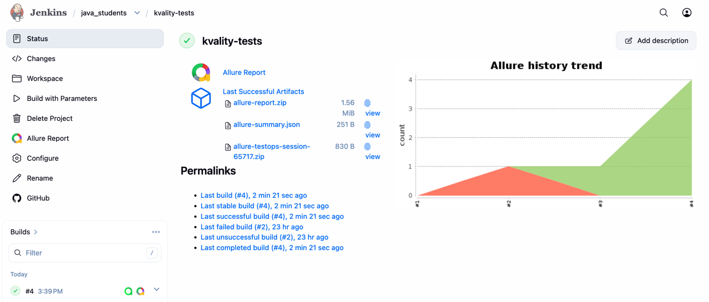
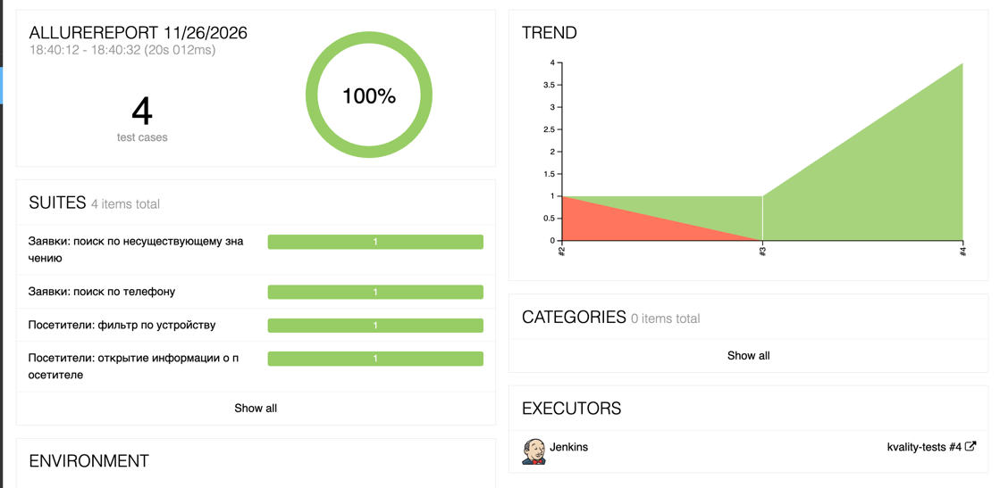
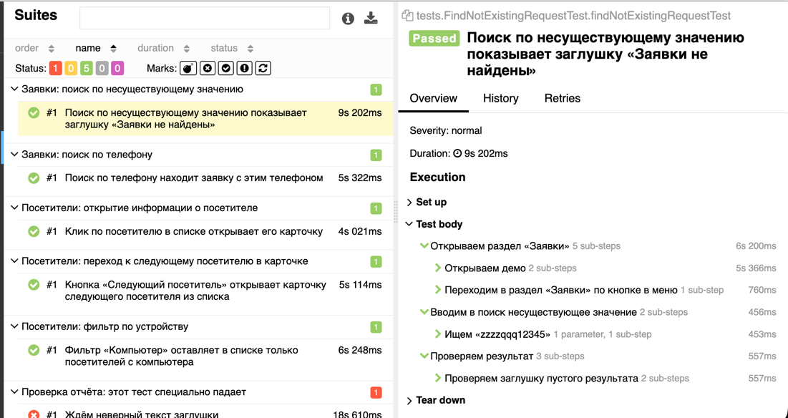

# Проект по автоматизации тестирования для сервиса Kvality

> Kvality — AI-квалификация лидов без CRM прямо в Telegram: AI анализирует заявки, менеджер подтверждает качество лида в Telegram, а Kvality передаёт вердикты и результаты квалификации в Яндекс Метрику для обучения рекламы.

## Содержание:

---

- [Технологии и инструменты](#технологии-и-инструменты)
- [Примеры автоматизированных тест-кейсов](#примеры-автоматизированных-тест-кейсов)
- [Сборка в Jenkins](#сборка-в-jenkins)
- [Запуск из терминала](#запуск-из-терминала)
- [Allure отчет](#allure-отчет)
- [Интеграция с Allure TestOps](#интеграция-с-allure-testops)
- [Интеграция с Jira](#интеграция-с-jira)
- [Уведомление в Telegram при помощи бота](#уведомление-в-telegram-при-помощи-бота)
- [Примеры видео выполнения тестов на Selenoid](#примеры-видео-выполнения-тестов-на-selenoid)

---

## Технологии и инструменты:


---

## Примеры автоматизированных тест-кейсов:

---

- ✓ _Поиск заявки по телефону из списка_
- ✓ _Поиск по несуществующему значению показывает заглушку «Заявки не найдены»_
- ✓ _Клик по посетителю в списке открывает его карточку_
- ✓ _Фильтр «Устройство: Компьютер» оставляет в списке только посетителей с компьютера_

---

## Сборка в Jenkins

---



### Параметры сборки в Jenkins:

- _ENV (окружение: local, stage или prod, по умолчанию local)_
- _browser (браузер, по умолчанию chrome)_
- _browserVersion (версия браузера, по умолчанию 157.0)_
- _browserSize (размер окна браузера, по умолчанию 1920x1080)_
- _headless (без открытия браузера, по умолчанию false)_
- _baseUrl (адрес тестируемого веб-сайта, по умолчанию https://kvality.io)_
- _remote (логин, пароль и адрес удаленного сервера Selenoid)_

## Запуск из терминала

---

___Локальный запуск:___

```
./gradlew clean test
```

___Удалённый запуск через Jenkins:___

```
clean test
"-DENV=${ENV}"
"-Dbrowser=${browser}"
"-DbrowserVersion=${browserVersion}"
"-DbrowserSize=${browserSize}"
"-Dheadless=${headless}"
"-DbaseUrl=${baseUrl}"
"-Dremote=${remote}"
```

---

## Allure отчет

---

### Основная страница отчёта



### Тест-кейсы



### Графики


---

## Интеграция с Allure TestOps

---

### Allure TestOps Dashboard


### Ручные тест-кейсы


### Авто тест-кейсы


---

## Интеграция с Jira

---


---

## Уведомление в Telegram при помощи бота

---


---

## Примеры видео выполнения тестов на Selenoid

---


